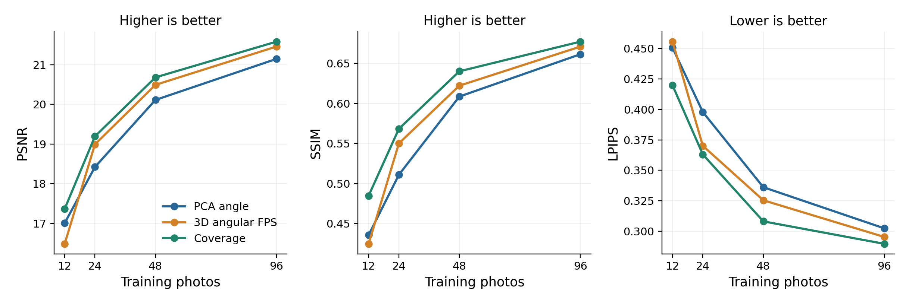
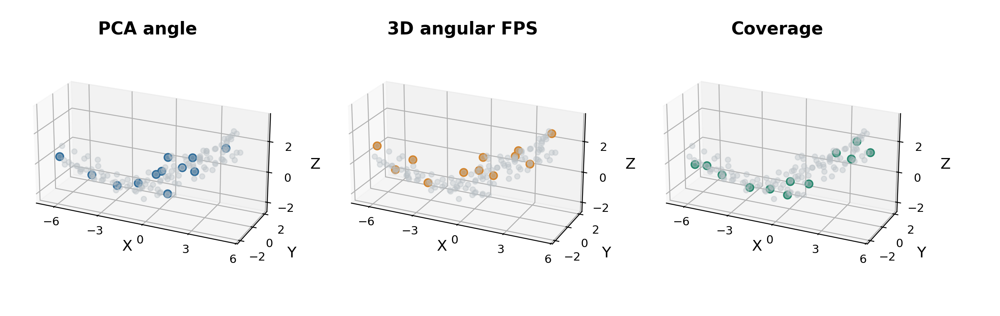
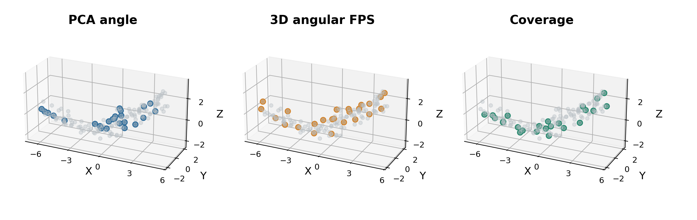
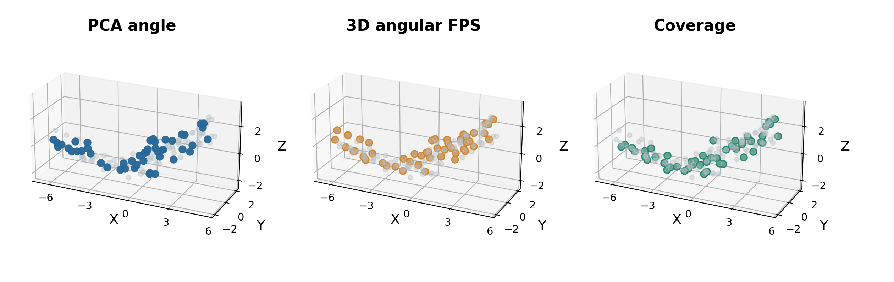
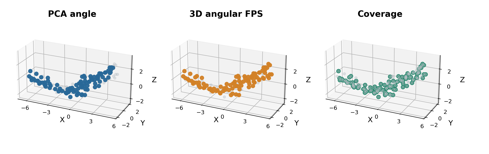

# Measured Flowers results

All 12 runs finished on 19 November 2026. Each value below averages the same 19 held-out photos.
Higher PSNR and SSIM are better; lower LPIPS is better. All models trained for 30,000 iterations.

| Training photos | Method | Test PSNR dB | Test SSIM | Test LPIPS | Feature points covered | Run minutes |
|---:|---|---:|---:|---:|---:|---:|
| 12 | PCA angle | 17.007 | 0.4356 | 0.4506 | 32.67% | 82.1 |
| 12 | 3D angular FPS | 16.485 | 0.4247 | 0.4557 | 34.05% | 78.8 |
| 12 | Coverage | 17.367 | 0.4848 | 0.4197 | 49.09% | 80.4 |
| 24 | PCA angle | 18.422 | 0.5109 | 0.3978 | 50.25% | 95.1 |
| 24 | 3D angular FPS | 18.992 | 0.5501 | 0.3701 | 57.09% | 89.8 |
| 24 | Coverage | 19.194 | 0.5683 | 0.3630 | 69.57% | 91.1 |
| 48 | PCA angle | 20.113 | 0.6087 | 0.3361 | 74.75% | 97.5 |
| 48 | 3D angular FPS | 20.492 | 0.6223 | 0.3254 | 80.41% | 96.5 |
| 48 | Coverage | 20.681 | 0.6402 | 0.3080 | 89.13% | 97.1 |
| 96 | PCA angle | 21.148 | 0.6615 | 0.3023 | 93.18% | 100.5 |
| 96 | 3D angular FPS | 21.458 | 0.6710 | 0.2952 | 98.21% | 100.5 |
| 96 | Coverage | 21.582 | 0.6773 | 0.2896 | 99.43% | 99.8 |

Coverage improved mean PSNR over PCA by 0.360, 0.772, 0.569 and 0.435 dB at 12, 24, 48 and 96 views.
It had the best test means for all three metrics at every count, but did not win on every individual test photograph.
Angular FPS beat PCA at 24, 48 and 96 views, but not at 12. These results cover one scene and seed 0.

## Selected cameras

Grey dots are the full candidate pool; coloured dots are the selected cameras. All panels use the same reconstruction frame.
These positions are relative reconstruction coordinates, not measured heights above the ground.

### 12 selected views

### 24 selected views

### 48 selected views

### 96 selected views

## Data files

- `summary.csv`: all final train/test means, point coverage and measured runtime for the 12 runs.
- `metrics/all_test_images.csv`: 228 per-test-image records, identified by original filename.
- `matched_examples.json`: the 36 presentation rows, with the same photo compared across all three methods.
- `metrics/`: per-run per-image tables, rank choices and evaluation checks.

Feature coverage counts distinct IDs among 51,695 eligible sparse COLMAP points. It is not entire surface coverage.
Runtime includes successful training, final rendering and evaluation; interrupted attempts and downtime are excluded.
The train set changes with the training budget, so use the fixed test means to compare quality across budgets.

The model uses full-scene COLMAP geometry, including test-assisted geometry. Test images do not receive training updates.
